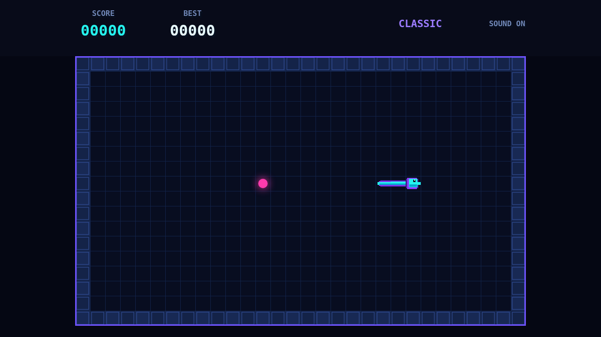

# Coil

Coil is a neon grid serpent built around one delicious pressure: the next pulse is worth more if you reach it quickly. Guide the bright head through the dark lattice, eat the pink pulses, and watch the body trace every choice behind you.

The serpent never stops. Every input queues a ninety-degree turn for the next tick, so clean routes come from looking a few cells ahead. The glowing border is lethal, and every extra pulse makes your own trail a little harder to escape.

Quick consecutive eats raise the combo from x2 all the way to x5. The bar above the board drains constantly; let it empty and the next pulse begins a new chain at x1.

Arrow keys or WASD steer, P or Escape pauses, and M toggles the synthwave soundtrack. Menus also work with mouse and touch.
